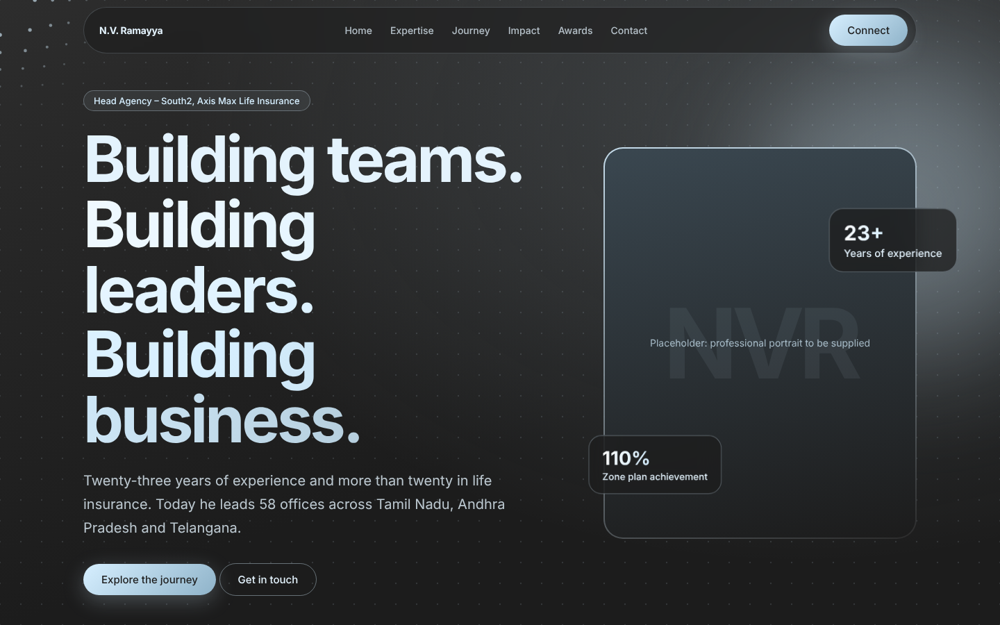
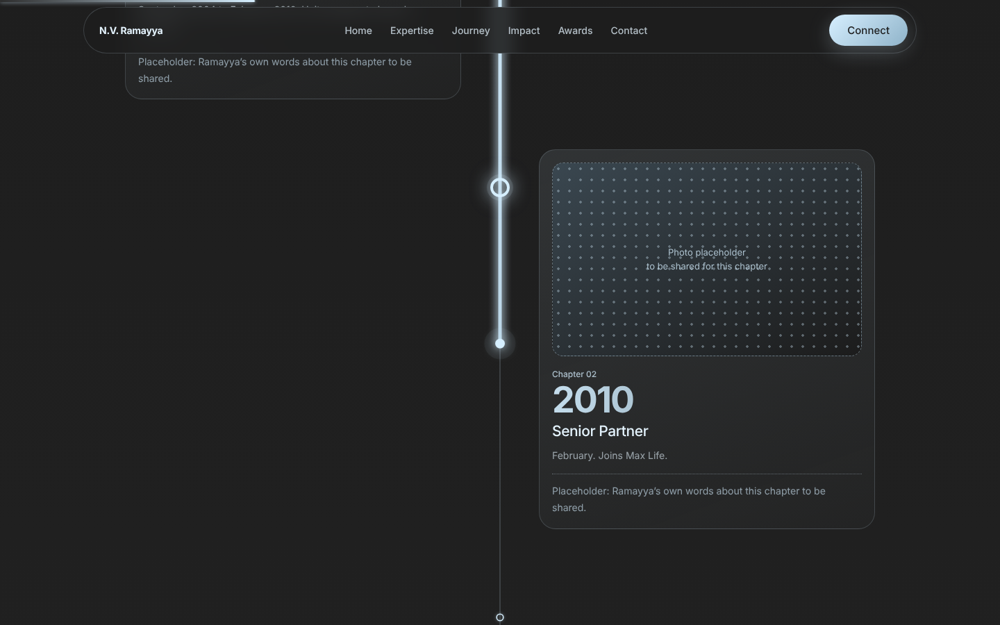
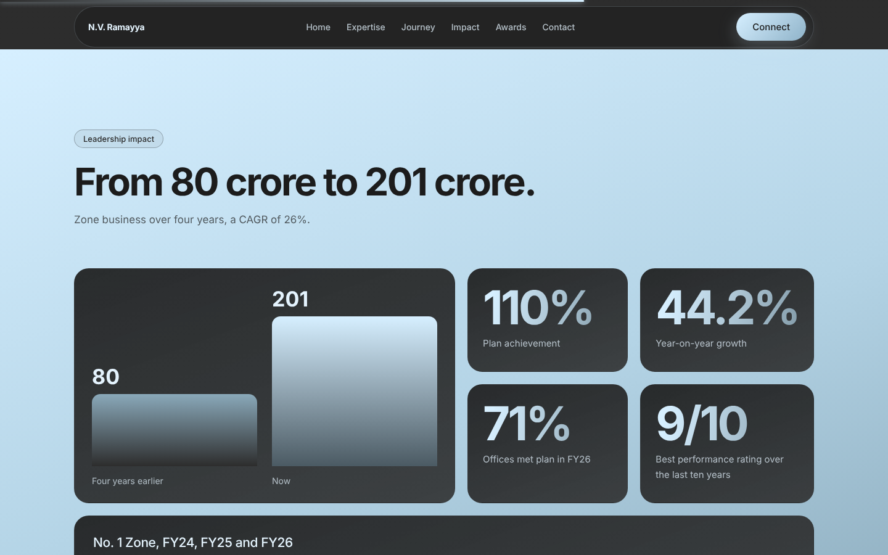

<div align="center">

# N.V. Ramayya

### The Architecture of Leadership

**A digital legacy site for a senior insurance and agency leader, built to tell a career as a story rather than list it as a CV.**




</div>

---

## The idea

N.V. Ramayya has spent 23+ years in business and sales, and more than 20 of them in life insurance. He began as an individual contributor and today leads the South2 agency across Tamil Nadu, Andhra Pradesh and Telangana, with 58 offices and 106 units.

This site turns that progression into a single scrolling journey: from contributor, to team builder, to regional leader, to senior executive.

## Highlights

- **Two-colour identity.** Charcoal (`#2D2D2D`, `#1C1C1C`) and Ice Blue (`#D6EFFF`), blended with gradients.
- **Cursor-responsive dot matrix.** A lightweight canvas field in the hero and selected sections. Dots lift away from the cursor, then settle back. It stays still on touch devices and with reduced-motion settings.
- **Chapter-by-chapter journey.** A centred timeline with chapters alternating left and right, a glowing line that fills as you scroll, and ring milestones that light up when reached.
- **Impact told with numbers.** Animated counters and a growth chart, each with its CV context.
- **Photo slots that fill themselves.** Drop an image into the right folder and it replaces the placeholder. No code changes.
- **Responsive and accessible.** Mobile menu, keyboard focus states, reduced-motion support.
- **Zero dependencies.** One static HTML file, with only Google Fonts (Sora and Manrope) loaded from the web.

## Preview

<div align="center">


</div>

## Sections

| # | Section | What it shows |
| --- | --- | --- |
| 1 | Hero | Title, positioning, portrait, headline stats |
| 2 | At a glance | 23+ years, 20+ in life insurance, 58 offices, 106 units, volumes with context |
| 3 | Expertise | Agency leadership, branch building, recruitment, leader development |
| 4 | Journey | Ten chapters from ICICI Prudential (2004) to Head Agency, South2 (2026) |
| 5 | Impact | Zone growth from 80 crore to 201 crore, plan achievement, rankings |
| 6 | Building leaders | Promotions and succession |
| 7 | Business transformation | Results at each stage of his career |
| 8 | Awards | CEO Business Stalwart 2022, DMM Best Zone FY23 to FY26, and more |
| 9 | Digital transformation | GROW, the digital PRP |
| 10 | Philosophy, foundation, contact | Leadership values, early career, education, contact |

## Repository structure

```
Dad-Portfolio/
├── index.html              # The complete website (HTML, CSS and JS in one file)
├── README.md
├── assets/
│   └── images/
│       ├── README.md       # Exact file names for every photo slot
│       ├── portrait/       # Hero portrait
│       ├── journey/        # One photo per journey chapter (10 slots)
│       └── team/           # Team photo for the Building leaders section
└── docs/                   # Preview screenshots used in this README
```

## Adding photos

Every placeholder on the site has a matching file name. Add the image to the folder and refresh.

| Where it appears | Save it as |
| --- | --- |
| Hero portrait | `assets/images/portrait/ramayya.jpg` |
| Journey chapters 1 to 10 | `assets/images/journey/chapter-01.jpg` to `chapter-10.jpg` |
| Team section | `assets/images/team/team-01.jpg` |

`.jpg`, `.jpeg`, `.png` and `.webp` all work. Full details and suggested sizes are in [`assets/images/README.md`](assets/images/README.md).

## Still to be supplied

Nothing below has been invented. These are marked as placeholders on the site:

- Professional portrait and a photo for each journey chapter
- Ramayya's own words for each chapter story
- Verified email and LinkedIn for the contact section
- Scope and outcomes of the GROW digital PRP
- His own wording for each leadership value
- Team photographs

## Run locally

No build step. Open `index.html` in any browser.

```bash
git clone https://github.com/AnupNarayanam/Dad-Portfolio.git
cd Dad-Portfolio
open index.html        # macOS. On Windows use: start index.html
```

## Publish with GitHub Pages

1. Go to **Settings**, then **Pages**.
2. Under **Build and deployment**, choose **Deploy from a branch**.
3. Select the `main` branch and the `/ (root)` folder, then save.
4. The site goes live at `https://anupnarayanam.github.io/Dad-Portfolio/`.

## Content accuracy

All figures come from the CV and are shown with their context.

- 201 crore (MFYP) and 235 crore (WFYP) are last-year volumes of the organisation he leads, not personal sales.
- 250 crore is the current-year budget for the role.
- Personal details such as date of birth, marital status and private contact information are intentionally left out.

## Built with

Plain HTML, CSS and JavaScript. HTML Canvas for the dot field. Typefaces: [Sora](https://fonts.google.com/specimen/Sora) and [Manrope](https://fonts.google.com/specimen/Manrope).

---

<div align="center">
<sub>Content © N.V. Ramayya. All rights reserved.</sub>
</div>
